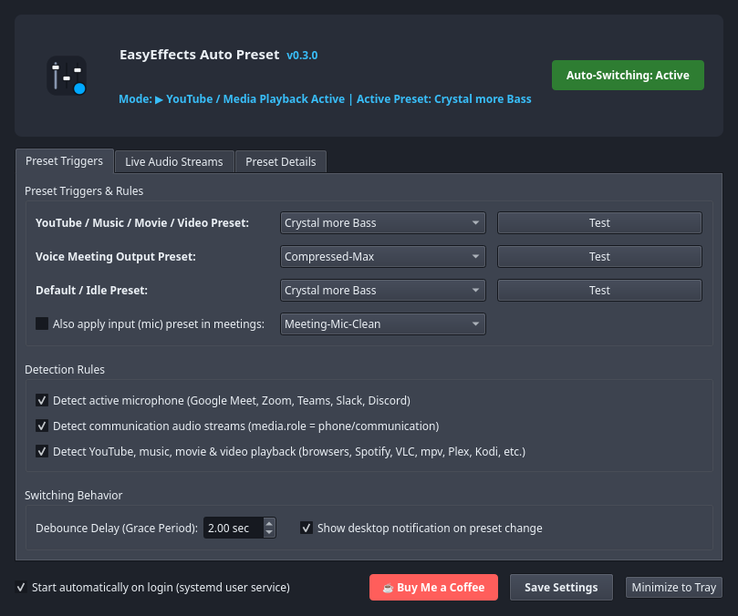
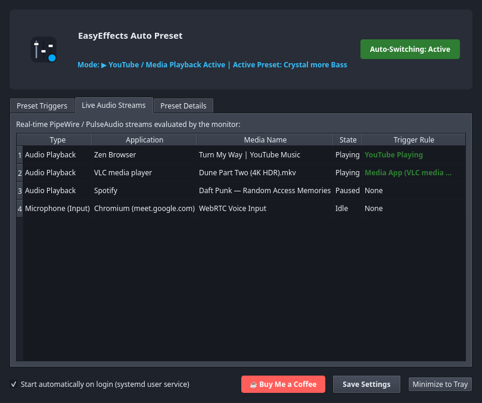
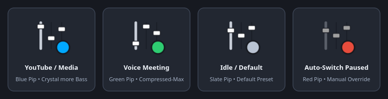

# EasyEffects Auto Preset

[](https://github.com/russellmilliner/easyeffects-auto-preset/releases/tag/v0.3.0)
[](https://github.com/russellmilliner/easyeffects-auto-preset/releases/download/v0.3.0/easyeffects-auto-preset-v0.3.0-x86_64.flatpak)
[](https://www.kernel.org/)
[](https://kde.org/plasma-desktop/)
[](https://pipewire.org/)
[](https://www.rust-lang.org/)
[](https://www.apache.org/licenses/LICENSE-2.0)
[](https://ko-fi.com/russellmilliner)

> **Context-aware, automatic audio preset switcher and system tray manager for [EasyEffects](https://github.com/wwmm/easyeffects) on Linux (PipeWire / PulseAudio).**

---

## 🎯 What Does EasyEffects Auto Preset Do?

[**EasyEffects**](https://github.com/wwmm/easyeffects) is a powerful system-wide DSP and equalizer for Linux, but **a preset tuned for music and movies sounds terrible in a voice meeting**—and vice versa:

- **Music, Movies & YouTube** benefit from deep sub-bass extension, warm low-end punch, and sparkling highs (e.g. **`Crystal more Bass`**).
- **Voice Meetings & Calls** (Google Meet, Zoom, Microsoft Teams, Slack, Discord) suffer when heavy bass is active: desk thumps, HVAC rumble, and male vocal proximity effect become boomy and fatiguing, while quiet and loud participants require fast dynamic leveling and speech-band clarity (e.g. **`Compressed-Max`** or **`Meeting-Voice-Clear`**).

**EasyEffects Auto Preset** eliminates manual preset switching completely. Running silently in the background (or in your system tray), it inspects your live **PipeWire / PulseAudio** audio streams (`sink-inputs` and `source-outputs`) every second and automatically loads the right EasyEffects preset based on a **3-tier priority engine**:

| Priority | Active Context | What Triggers It | Default Preset Applied |
| :---: | :--- | :--- | :--- |
| **1 (Highest)** | **🎤 Voice Meeting / Call** | • Any active microphone recording stream (`source-outputs`)<br>• Native meeting apps (`zoom`, `teams`, `slack`, `discord`, `webex`, `skype`, `signal-desktop`, `telegram-desktop`)<br>• Browser tabs & streams matching `meet.google.com`, `Google Meet`, `Zoom Meeting`, `Teams Call`, `Slack Huddle`, `Discord Call`<br>• Any stream with `media.role` = `phone` or `communication` | **`Compressed-Max`** *(or **`Meeting-Voice-Clear`**)*<br>+ optional input preset (**`Meeting-Mic-Clean`**) |
| **2** | **▶ YouTube, Music, Movies & Video** | • **Web Browsers & Streaming**: Active audio playback (`Corked: no`) on YouTube, YouTube Music, Netflix, Disney+, Prime Video, Hulu, Max, Peacock, Paramount+, Apple TV, Crunchyroll, Twitch, Vimeo, Plex, Jellyfin, Emby, Spotify, SoundCloud, Tidal, Deezer, Qobuz, Bandcamp, Pandora, Apple Music<br>• **Native Video & Movie Players**: `vlc`, `mpv`, `celluloid`, `haruna`, `totem` (GNOME Videos), `clapper`, `showtime`, `dragon`, `kaffeine`, `smplayer`, `kodi`, `plex`, `jellyfinmediaplayer`, `stremio`, `freetube`<br>• **Native Music Players**: `spotify`, `elisa`, `strawberry`, `clementine`, `rhythmbox`, `amberol`, `lollypop`, `g4music`, `audacious`, `deadbeef`, `qmmp`, `cmus`, `mpd`, `cantata`, `amarok`, `quodlibet`, `fooyin`, `tauonmb`, `feishin`, `supersonic`, `plexamp`, `shortwave`<br>• **PipeWire Media Roles**: Any playing stream with `media.role` = `music`, `video`, or `movie` | **`Crystal more Bass`** |
| **3 (Fallback)** | **🎵 Default / Idle** | • No active voice call and no active media playback after the configurable **debounce grace period** (default `2.0s`) expires | **`Crystal more Bass`** *(or your chosen idle preset)* |

### Why Smart Debouncing Matters
When you skip a track on Spotify, buffer a YouTube video, or pause between sentences in a meeting, PipeWire briefly marks the stream as corked/idle. **EasyEffects Auto Preset** waits for a configurable **Debounce Grace Period** (default `2.0 seconds`) before leaving Meeting or Media mode—preventing jarring preset switches during momentary audio gaps.

---

## 📸 Screenshots

### 1. Preset Triggers, Detection Rules & Switching Behavior


### 2. Real-Time PipeWire / PulseAudio Live Stream Inspector


### 3. How It Works, Bundled Presets & Built-in Update Checker


### 4. Dynamic System Tray Status Badges


---

## 📥 Release & Downloads (`v0.3.0`)

| Asset | Download Link | Description |
| :--- | :--- | :--- |
| **Flatpak Bundle (`x86_64`)** | [**`easyeffects-auto-preset-v0.3.0-x86_64.flatpak`**](https://github.com/russellmilliner/easyeffects-auto-preset/releases/download/v0.3.0/easyeffects-auto-preset-v0.3.0-x86_64.flatpak) ([SHA-256](https://github.com/russellmilliner/easyeffects-auto-preset/releases/download/v0.3.0/easyeffects-auto-preset-v0.3.0-x86_64.flatpak.sha256)) | Self-contained Flatpak bundle (`org.kde.Platform//6.11`) with Rust daemon, PyQt6 GUI & bundled presets |
| **Linux Release Archive (`x86_64`)** | [**`easyeffects-auto-preset-v0.3.0-linux-x86_64.tar.gz`**](https://github.com/russellmilliner/easyeffects-auto-preset/releases/download/v0.3.0/easyeffects-auto-preset-v0.3.0-linux-x86_64.tar.gz) ([SHA-256](https://github.com/russellmilliner/easyeffects-auto-preset/releases/download/v0.3.0/easyeffects-auto-preset-v0.3.0-linux-x86_64.tar.gz.sha256)) | Native Rust daemon binary, PyQt6 GUI & tray script, custom EasyEffects presets, systemd user service & desktop entry |
| **Standalone Rust Daemon (`x86_64`)** | [**`easyeffects-auto-preset-v0.3.0-x86_64`**](https://github.com/russellmilliner/easyeffects-auto-preset/releases/download/v0.3.0/easyeffects-auto-preset-v0.3.0-x86_64) ([SHA-256](https://github.com/russellmilliner/easyeffects-auto-preset/releases/download/v0.3.0/easyeffects-auto-preset-v0.3.0-x86_64.sha256)) | Standalone compiled Rust CLI/daemon binary |

### Quick Flatpak Install (from GitHub Release)

```bash
curl -LO https://github.com/russellmilliner/easyeffects-auto-preset/releases/download/v0.3.0/easyeffects-auto-preset-v0.3.0-x86_64.flatpak
flatpak install --user -y easyeffects-auto-preset-v0.3.0-x86_64.flatpak
flatpak run io.github.russellmilliner.easyeffects_auto_preset
```

---

## ☕ Support the Project

If you find EasyEffects Auto Preset helpful for your audio workflow and meetings, consider supporting continued development:

[](https://ko-fi.com/russellmilliner)

👉 **[Support Russell Milliner on Ko-fi](https://ko-fi.com/russellmilliner)**

---

## ✨ Key Features

- 🎧 **Universal Music, Movie, Video & YouTube Detection:** Automatically switches to your media preset (**`Crystal more Bass`**) whenever audio is actively playing in web browsers (YouTube, YouTube Music, Netflix, Disney+, Prime Video, Twitch, Plex, SoundCloud, etc.) or native desktop media players (Spotify, VLC, mpv, Celluloid, Haruna, Elisa, Strawberry, Rhythmbox, Amberol, Lollypop, Audacious, Kodi, Plex, Jellyfin, Stremio, FreeTube).
- 🎤 **Automatic Voice Meeting Detection (Top Priority):** Immediately switches to **`Compressed-Max`** or **`Meeting-Voice-Clear`** (plus optional **`Meeting-Mic-Clean`** input preset) whenever a voice meeting or microphone stream is active.
- 🔄 **Smart Grace-Period Debouncing:** Configurable delay (default `2.0s`) prevents abrupt preset flapping during track changes, video buffering, or brief pauses in conversation.
- 🦀 **Dual Architecture (Rust + Python/Qt6):**
  - **Native Rust CLI & Daemon (`easyeffects-auto-preset`):** Memory-safe, zero-overhead background engine consuming **<4MB RSS** and ~0% CPU.
  - **PyQt6 Settings & System Tray Manager (`python/easyeffects_auto_preset.py`):** Full graphical settings dialog, live PipeWire stream inspector table, one-click preset testing, and tray quick-override menu.
- 🎨 **Dynamic System Tray Status Icon:**
  - 🔵 **Blue pip:** YouTube, music, movie, or video playback active
  - 🟢 **Green pip:** Voice meeting / call active
  - ⚪ **Slate pip:** System idle / default preset
  - 🔴 **Red pip:** Auto-switching paused
- 🔔 **Built-in Update Checker:** Automatic startup update checks and manual one-click update checks via the GUI, system tray menu (`Check for Updates...`), and CLI (`--check-update` / `-u`) against GitHub Releases.
- 📦 **Native & Flatpak EasyEffects Support:** Automatically detects whether EasyEffects is installed natively (`easyeffects`) or via Flatpak (`com.github.wwmm.easyeffects`).

---

## 🎛️ Bundled EasyEffects Presets

The repository includes curated presets ready to install into EasyEffects:

| Preset | Channel | Purpose & Audio Characteristics |
|---|---|---|
| **`Meeting-Voice-Clear`** | Output | **Voice Meeting Optimization:** Aggressive low-frequency high-pass cut (-32 dB at 32Hz, -24 dB at 64Hz, -10 dB at 125Hz) to remove table thumps, HVAC drone, and proximity rumble. +4dB presence boost in the 1.5–4kHz speech clarity range, Speex denoiser (-70 dB) and dereverberation to kill room echo, plus fast dynamic compression to equalize loud and quiet speakers. |
| **`Meeting-Mic-Clean`** | Input | **Microphone Cleanliness:** Speex noise suppression, room dereverberation, and Automatic Gain Control (AGC) for your outbound microphone. |
| **`Crystal more Bass`** | Output | **Media, Movies & Music:** Rich, punchy low-end response with crystalline highs, tuned for music, movies, videos, and YouTube. |
| **`Compressed-Max`** | Output | **Maximum Leveling:** High-ratio dynamic compression + maximizer ceiling. |

To install the presets into EasyEffects:
```bash
chmod +x presets/install-presets.sh
./presets/install-presets.sh
```

---

## 🚀 Building & Usage

### Option 1: Native Rust CLI & Daemon

```bash
# Build optimized release binary
cargo build --release

# Print current loaded preset and live meeting/media detection status
./target/release/easyeffects-auto-preset --status

# List all available EasyEffects output and input presets
./target/release/easyeffects-auto-preset --list-presets

# Switch output preset immediately
./target/release/easyeffects-auto-preset --switch "Crystal more Bass"

# Check GitHub Releases for a newer version
./target/release/easyeffects-auto-preset --check-update

# Run the background auto-switching daemon
./target/release/easyeffects-auto-preset --daemon
```

### Option 2: PyQt6 System Tray & Settings GUI

```bash
# Launch the settings window + system tray manager
python3 python/easyeffects_auto_preset.py

# Launch minimized directly to the system tray
python3 python/easyeffects_auto_preset.py --minimized

# Check for updates from the CLI
python3 python/easyeffects_auto_preset.py --check-update
```

### Option 3: Systemd User Service (Autostart on Login)

```bash
mkdir -p ~/.config/systemd/user/
cp systemd/easyeffects-auto-preset.service ~/.config/systemd/user/
systemctl --user daemon-reload
systemctl --user enable --now easyeffects-auto-preset.service
```

---

## 📦 Building the Flatpak Bundle

```bash
chmod +x scripts/build-flatpak.sh

# Build the .flatpak bundle in target/release/
./scripts/build-flatpak.sh

# Build and immediately install into your user Flatpak installation
./scripts/build-flatpak.sh --install
```

---

## 🛠️ Interactive Release & GitHub Sync Scripts

Interactive multi-project release and sync scripts are located in the parent workspace directory (`/home/millinr/Builds/`) and let you choose which project to work on interactively:

| Script | Purpose & Usage |
| :--- | :--- |
| **`../release-menu.sh`** | Unified interactive menu: choose which project in `~/Builds` to work on, then choose whether to bump version, sync to GitHub, deploy a release, or run tests. |
| **`../bump-version.sh`** | Select a project and interactively increment Patch, Minor, Major, or Custom version across `Cargo.toml`, `src/main.rs`, `python/easyeffects_auto_preset.py`, `README.md`, AppStream `metainfo.xml`, and UI screenshots. |
| **`../sync-github.sh`** | Select a project and interactively stage files (`all`, `tracked`, or `patch`), commit, optionally tag `vX.Y.Z`, and push to GitHub. |
| **`../deploy-release.sh`** | Select a project and run the end-to-end release pipeline (optional version bump → tests → Rust binary + Linux `.tar.gz` + Flatpak bundle + SHA-256 checksums → git tag/push → GitHub Release creation via `gh`). |

---

## ⚙️ Configuration (`~/.config/easyeffects-auto-preset/config.json`)

```json
{
  "enabled": true,
  "youtube_preset": "Crystal more Bass",
  "meeting_preset": "Compressed-Max",
  "default_preset": "Crystal more Bass",
  "meeting_mic_preset": "Meeting-Mic-Clean",
  "apply_mic_preset": false,
  "debounce_seconds": 2.0,
  "check_interval_seconds": 1.0,
  "detect_microphone": true,
  "detect_communication_role": true,
  "detect_meeting_apps": true,
  "detect_youtube": true,
  "detect_media_apps": true,
  "show_notifications": true,
  "minimize_on_startup": true,
  "check_updates_on_startup": true
}
```

---

## 📄 License

Licensed under the Apache License, Version 2.0 (the "License");  
you may not use this file except in compliance with the License.  
You may obtain a copy of the License at

    http://www.apache.org/licenses/LICENSE-2.0

Unless required by applicable law or agreed to in writing, software  
distributed under the License is distributed on an "AS IS" BASIS,  
WITHOUT WARRANTIES OR CONDITIONS OF ANY KIND, either express or implied.  
See the [LICENSE](LICENSE) and [NOTICE](NOTICE) files for details.

---

## 👤 Author

**Russell Milliner**
- GitHub: [@russellmilliner](https://github.com/russellmilliner)
- Ko-fi: [Buy Me a Coffee](https://ko-fi.com/russellmilliner)
